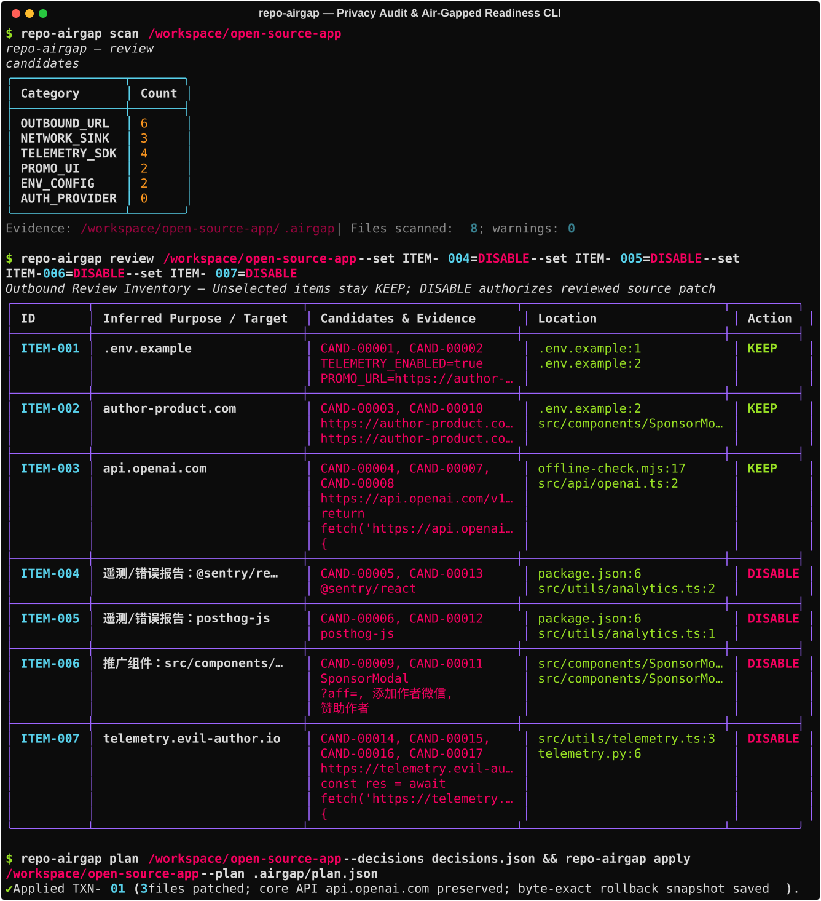

<div align="center">

# 🛡️ repo-airgap — Privacy Audit & Air-Gapped Readiness Tool

[](LICENSE)
[](pyproject.toml)
[](SKILL.md)
[](#workflow)
<br/>
[](#agent-skill)
[](#scope-and-limits)

**Static Outbound & Telemetry Audit · Context-Aware Agent Review · Local SQLite Auth Adapter · Byte-Exact Reversible Patches**

[**English**](README.md) · [**简体中文**](README_CN.md)

<br/>



</div>

---

## 📖 Overview

Version 0.1 provides a local Python CLI and an Agent Skill for reviewing optional outbound requests, telemetry, and promotional UI in source repositories. The scanner produces static candidates; an Agent or human reviews business context, supplies exact edits, and then checks and applies a reversible modification plan.

The CLI makes **no remote model or API requests** and **does not execute target code** during scanning. Scan results are review candidates, not malice verdicts.

## 🚀 Install

Python 3.11+ is required. From this checkout:

```powershell
uv venv --python 3.12 .venv
uv pip install --python .venv/Scripts/python.exe -e ".[dev]"
# Only needed to run the generated Flask local-auth adapter:
uv pip install --python .venv/Scripts/python.exe -e ".[auth]"
.venv/Scripts/repo-airgap.exe --help
```

On macOS/Linux use `.venv/bin/python` and `.venv/bin/repo-airgap`. For a regular package installation use `python -m pip install .`; only `rich` and `pathspec` are core dependencies. Development checks use `pytest` and `ruff`. Offline machines need these dependencies staged beforehand; `scan` does not download them.

## 🔄 Workflow

Replace `/target` with the absolute repository directory. The commands below assume `repo-airgap` is on `PATH`; otherwise use the virtual environment executable.

```text
repo-airgap scan /target
repo-airgap scan /target --format csv
repo-airgap scan /target --ignore-id promo_keyword --severity MEDIUM
repo-airgap review /target
repo-airgap review /target --set ITEM-001=DISABLE --set ITEM-002=KEEP
repo-airgap plan /target --decisions /reports/decisions.json
repo-airgap apply /target --plan /target/.airgap/plan.json
repo-airgap verify /target --command '["python","-m","pytest"]'
repo-airgap report /target
repo-airgap revert /target
```

The scan writes evidence under `/target/.airgap/`, without changing target source. Add `.airgap/` to the target's `.gitignore` manually if needed. `--output` exports an additional JSON copy to an external path, or a path under `.airgap`. CSV is written to stdout (`--format csv`); on older Windows PowerShell use an explicit UTF-8 output encoding when redirecting non-ASCII content.

`review` groups outbound candidates by destination/purpose and defaults unselected items to `KEEP`. Only items explicitly set to `DISABLE` may enter a normal sanitization plan; Google authentication items additionally support `REPLACE_LOCAL_AUTH`. Here, `DISABLE` means applying a reviewed source patch to selected call sites—it does not disconnect the OS network or prove zero runtime traffic. Reviewers provide exact replacements for selected candidates following the [decisions format](references/decisions.md). `plan` does not modify source; inspect the full diff before calling `apply`. Plans are refused if `.airgap/user_choices.json` is missing or out of sync with the current scan.

### Local Authentication Migration (Flask)

The initial local authentication adapter supports simple module-level Flask applications:

```text
repo-airgap auth inspect /target
repo-airgap review /target --set ITEM-001=REPLACE_LOCAL_AUTH
repo-airgap auth plan /target --mapping /path/flask-auth-mapping.json
repo-airgap apply /target --plan /target/.airgap/plan.json
repo-airgap auth user-add --database /private/auth.sqlite3 --email user@example.com --user-id U001 --password-env LOCAL_AUTH_PASSWORD
```

See [references/flask-auth-mapping.example.json](references/flask-auth-mapping.example.json) for a copyable mapping template. Migration generates a local SQLite user/session runtime with password hashing, CSRF protection, role checks, and failed-login rate limiting, while returning `410` on the legacy Google callback. It does not turn Google business services (Drive, Gmail, etc.) into local capabilities, nor does it auto-claim legacy accounts by email; user import requires verified `business_id` and `google_sub` mappings before an administrator sets a new password. Projects with existing `Flask-Login`, `Blueprint`, Google OAuth SDKs (`Authlib`, `Flask-Dance`, `google-auth-oauthlib`), complex OAuth flows, or Google business API dependencies stop at the manual-adaptation boundary to avoid intercepting routes while leaving import-time or init-time OAuth side effects active.

### Artifacts & Transaction Safety

| Output | Purpose |
| --- | --- |
| `.airgap/audit_candidates.json` | Candidates with file hashes and redacted context |
| `.airgap/outbound_inventory.json` | Outbound targets and call-site index |
| `.airgap/review_prompt.json` | Local Agent review handoff |
| `.airgap/plan.json`, `plan.patch` | Reviewed exact replacement snapshots and diff |
| `.airgap/manifest.json` | Current transaction and rollback snapshots |
| `.airgap/airgap-sanitized.patch` | Only this tool's applied changes |
| `.airgap/verification.json` | Explicit verification commands and runtime evidence |
| `.airgap/AIRGAP_REPORT.md` | Applied, retained, and unresolved audit evidence |

The original bytes are the baseline, including uncommitted user work. The tool never resets the working tree. Changed baselines stop application; later edits to touched files stop rollback before any file is restored. Unrelated files remain outside the transaction. Per-file atomic replacement and a recovery journal support interrupted `apply`/`revert`. Inspect a leftover `mutation.lock` before removing it after a crash and confirm no mutation process is still running.

Plans and manifests contain full source snapshots; patches can contain secrets. Secret redaction in scan/report output is best-effort. Keep `.airgap` and decision files local and private. Plans are trusted change intent, not signed artifacts—always inspect the full diff when accepting a plan from another person.

## 🤖 Agent Skill

The entrypoint is [SKILL.md](SKILL.md). It includes classification, exact-edit, verification, and rollback instructions, with references for schemas and return-contract stubs. The project also supplies [`agents/openai.yaml`](agents/openai.yaml) and [`.cursorrules`](.cursorrules).

To make the skill discoverable, place the project folder (including `SKILL.md` and `references/`) under the agent's skills directory, or use that agent's supported local-skill installation method. Install the CLI first. This development checkout does not automatically change global agent settings or install a skill into every agent. Codex discovery typically uses `~/.codex/skills/repo-airgap/`. Invoke it as `$repo-airgap`, specifying the target repository and desired scope.

The distributable `dist/repo-airgap-skill-0.1.0.zip` includes a `repo-airgap/` folder with the Skill, CLI source, rules, references, and tests. Extract that folder into the agent's skills directory and install the CLI from that extracted folder. The zip excludes virtual environments and target audit evidence.

## 🔌 Optional Tools

* **Semgrep JSON/SARIF Import**: `repo-airgap scan /target --semgrep-report /reports/semgrep.json`. Explicit source URI locations and rule IDs are imported; full taint traces and SARIF artifact-index references are not supported in 0.1.
* **mitmproxy Exporter**: The optional [mitmproxy exporter](scripts/mitmproxy_export.py) writes normalized observation metadata without bodies, headers, or URL query strings.
* **Runtime Observations**: `repo-airgap verify /target --observations /reports/runtime.json` imports normalized runtime observations. OpenSnitch records may be converted manually; no native OpenSnitch adapter is bundled.

See [runtime evidence format and limits](references/runtime.md).

## ⚠️ Scope and Limits

* **Static Coverage**: Scan covers UTF-8 source, nested `.gitignore`, URLs, quoted bare domains, public IPs, common HTTP/socket/DNS/upload calls, telemetry manifests/imports, promotion keywords, and environment/container switches. It skips generated, binary, linked, oversized, and legal files. A 3–5 second scan is a design target, not a measured guarantee for arbitrary repositories.
* **Static Analysis Boundaries**: Static rules do not prove complete data flow. A nearest function declaration is a navigation hint. Credentials/high-entropy strings near a sink are review signals, not standalone exfiltration findings. Dynamic destinations stay unknown.
* **Supported Edit Languages**: Exact source edits support Python/JS/TS/JSX/TSX/Vue/Svelte/HTML. Python syntax is checked during planning/application; JS/TS and framework builds require the target's build commands. Other languages use separately reviewed manual patches.
* **Verification Execution**: `verify` runs only supplied argv commands with no inferred shell or project installation. Those commands execute code: use a suitable isolated environment. It records results, not semantic equivalence. No supplied commands means `not_verified`.
* **No OS-Level Isolation Guarantee**: **The CLI does not disconnect the OS network or certify air-gap readiness.** Run critical flows under actual network isolation and collect independent evidence. Proxy observations cover only routed traffic; empty captures prove neither absence of requests nor complete path coverage.
* **Legal Heuristics**: License/attribution safeguards are conservative heuristics. Review all changes; preserving legal lines does not prove compliance with every upstream license.

## 🧪 Development and Reproducible Demo

```powershell
.venv/Scripts/python.exe -m compileall -q src
.venv/Scripts/python.exe -m pytest
.venv/Scripts/ruff.exe check src tests scripts
.venv/Scripts/python.exe scripts/demo.py --output .airgap-demo
.venv/Scripts/python.exe scripts/package_skill.py
```

The demo copies the fixture, scans it, creates and applies a reviewed telemetry stub, runs Python and Node return-contract tests, produces a report, and then proves byte-exact rollback. Node 22.6+ with `--experimental-strip-types` is needed for the TypeScript fixture runtime. There is no dependency installation for the fixture. Its process-level fetch/socket guards prevent those tested calls from real I/O; they are not OS-level isolation and do not cover all network mechanisms. Choose a fresh demo output directory on repeat runs; existing directories are never overwritten.

## 📚 References

* [repo_scanner](https://github.com/0vatsa/repo_scanner): reference detection ideas; no implementation or rules copied from this repository, which had no declared license at the time of research.
* [Semgrep](https://github.com/semgrep/semgrep): optional static analysis report import.
* [mitmproxy](https://github.com/mitmproxy/mitmproxy) and [OpenSnitch](https://github.com/evilsocket/opensnitch): optional runtime network evidence.
* [ungoogled-chromium design](https://github.com/ungoogled-software/ungoogled-chromium/blob/master/docs/design.md): ordered patch and baseline ideas. Chromium-specific patches are not reused.
* The supplied `disruptiq/network-mapper-agent` URL returned 404 during research; no code dependency or maturity claim relies on it.

## ⚖️ Disclaimer

1. **Intended Use**: `repo-airgap` assists privacy audits, de-telemetry, and offline adaptation of software you have permission to modify, subject to its MIT, Apache-2.0, GPL, BSD, or other applicable license.
2. **No License Bypass**: It provides no license-key, paywall, or DRM bypass functionality.
3. **Respect Copyright**: Preserve upstream licenses, notices, and attribution, and comply with redistribution requirements.
