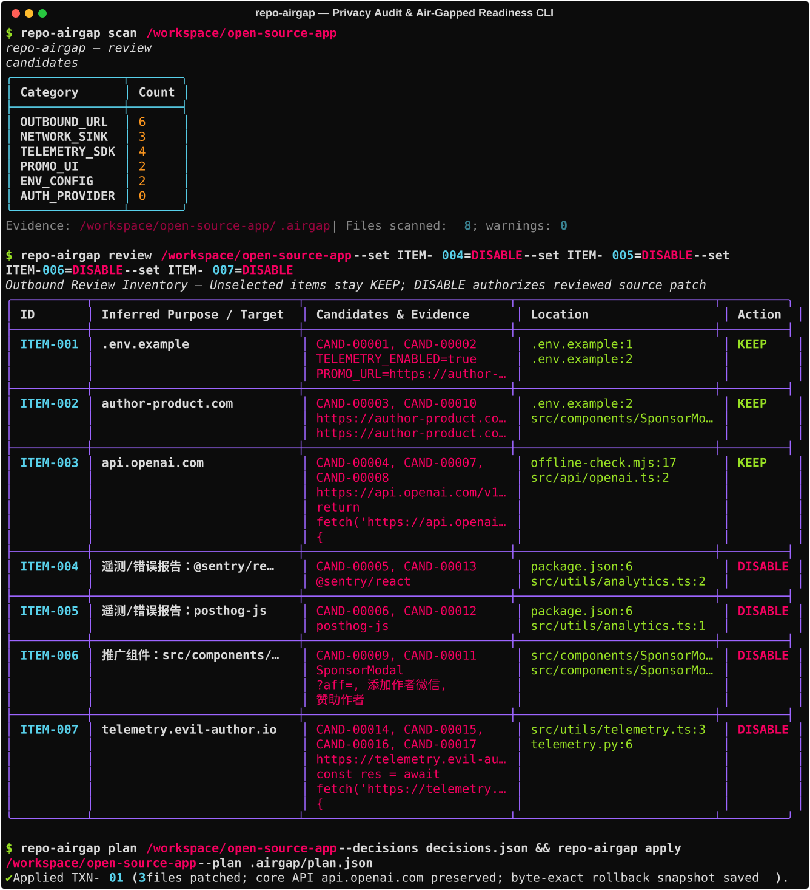

<div align="center">

# 🛡️ repo-airgap — 源码隐私外联审计与内网离线化改造工具

[](https://github.com/Hero-all/repo-airgap/actions/workflows/ci.yml)
[](https://github.com/Hero-all/repo-airgap/releases)
[](LICENSE)
[](pyproject.toml)
[](SKILL.md)
<br/>
[](#-%E4%BD%BF%E7%94%A8%E6%B5%81%E7%A8%8B)
[](#-%E6%99%BA%E8%83%BD%E4%BD%93%E6%8A%80%E8%83%BD-agent-skill)
[](#-%E8%83%BD%E5%8A%9B%E8%BE%B9%E7%95%8C)

**源码级外联与遥测静态扫描 · AI Agent 结合上下文语义研判 · 本地 SQLite 认证替换 · 事务级快照补丁与字节级无损回滚**

[**English**](README.md) · [**简体中文**](README_CN.md)

<br/>



</div>

---

## 📖 项目简介

`repo-airgap`（0.1 版）提供一套本地 Python CLI 工具与 AI Agent Skill（智能体技能）：用于扫描代码仓库中的可选外联请求、遥测上报（Telemetry）、公网 CDN 依赖以及推广弹窗 UI，结合调用方上下文进行业务语义研判，进而生成**可审阅、可验证、可字节级无损回滚**的精确离线化改造计划。

* **本地零外联扫描**：CLI 本身完全在本地运行，不发送任何云端模型或 API 请求，也不在扫描阶段执行目标仓库代码。
* **审慎改造**：扫描结果仅为候选证据而非恶意判定；未明确勾选停用的功能默认全部保留（`KEEP`）。

> [!NOTE]
> **项目状态：Alpha。** 已在自带样例和 4 个真实开源项目上验证（见 [基准测试结果](benchmarks/RESULTS.md)），仍会有误报和漏报，欢迎提 Issue。

### ⚡ 离线就绪提示（无需改代码）

很多框架官方就提供了关闭遥测或强制离线的开关。`scan` 会根据依赖清单（`package.json`、`requirements*.txt`、`pyproject.toml`）和代码识别这些框架，检查仓库里是否已经设置了对应开关，并把缺失的开关写入 `.airgap/offline.env`。上方截图就是对 [text-generation-webui](https://github.com/oobabooga/text-generation-webui) 执行 `repo-airgap scan` 的真实输出，未经修改。

目前覆盖 27 个框架/工具（Next.js、Nuxt、Gatsby、Astro、Storybook、Angular CLI、Turborepo、Expo、Prisma、Cypress、Playwright、Puppeteer、Electron、Hugging Face、Gradio、Streamlit、Chroma、Ray、W&B、Haystack、Unstructured、Semgrep、tiktoken、.NET、Yarn Berry 等），并能识别构建期/运行期下载：`from_pretrained`、`hf_hub_download`、`nltk.download`、`torch.hub.load`、tiktoken 编码文件、`next/font/google`、Dockerfile 中的 `RUN` 联网安装与公网基础镜像。规则见 [`rules/offline_switches.json`](rules/offline_switches.json)，每条都附官方文档链接。

默认不把测试/fixture/spec 文件、压缩打包产物，以及 `localhost`、内网 IP、Docker 服务名等本地地址计入候选；如需扫描测试代码，加 `--include-tests`。

## 🚀 安装指南

需要 Python 3.11 及以上版本。

### 一键全局安装（无需手动克隆源码）

```bash
# 使用 uv（推荐）：
uv tool install git+https://github.com/Hero-all/repo-airgap.git

# 或使用 pip / pipx：
pip install git+https://github.com/Hero-all/repo-airgap.git
```

### 本地源码安装（开发与调试）

```powershell
uv venv --python 3.12 .venv
uv pip install --python .venv/Scripts/python.exe -e ".[dev]"
# 仅在运行生成的 Flask 本地认证适配器时需要安装：
uv pip install --python .venv/Scripts/python.exe -e ".[auth]"
.venv/Scripts/repo-airgap.exe --help
```

在 macOS / Linux 下请使用 `.venv/bin/python` 和 `.venv/bin/repo-airgap`。普通安装可直接执行 `python -m pip install .`，核心运行仅依赖 `rich` 和 `pathspec`；开发检查使用 `pytest` 和 `ruff`。若在纯内网离线机器上使用，请提前准备上述依赖包，`scan` 不会联网下载依赖。

## 🔄 使用流程

请将下方命令中的 `/target` 替换为目标代码仓库的绝对路径（假设 `repo-airgap` 已加入 `PATH`，否则请使用虚拟环境下的可执行文件路径）：

```text
repo-airgap scan /target
repo-airgap scan /target --format csv
repo-airgap scan /target --ignore-id promo_keyword --severity MEDIUM
repo-airgap review /target
repo-airgap review /target --set ITEM-001=DISABLE --set ITEM-002=KEEP
repo-airgap plan /target --decisions /reports/decisions.json
repo-airgap apply /target --plan /target/.airgap/plan.json
repo-airgap verify /target --command '["python","-m","pytest"]'
repo-airgap report /target
repo-airgap revert /target
```

* `scan` 会将静态扫描证据写入 `/target/.airgap/`，不会改动目标源码。如有需要可手动将 `.airgap/` 加入目标项目的 `.gitignore`。`--output` 支持额外导出一份 JSON 到外部路径或 `.airgap` 下；`--format csv` 会输出到标准输出（在旧版 Windows PowerShell 中重定向中文内容时请显式指定 UTF-8 编码）。
* `review` 会把外联按目标/用途归类为清单，并将未选择项默认设为 `KEEP`。只有用户明确设为 `DISABLE` 的条目才允许进入常规净化计划；Google 登录项另支持 `REPLACE_LOCAL_AUTH`。此处的 `DISABLE` 指对选定源码调用点应用经审阅的停用补丁，**不等于操作系统级断网，也不代表运行时已证明零外联**。
* 审阅者按 [decisions 格式](references/decisions.md) 为已选候选提供精确替换后，执行 `plan` 生成补丁（`plan` 不修改源码）。检查完整 diff 无误后调用 `apply`。若缺少 `.airgap/user_choices.json` 或选择与当前扫描结果不一致，计划会拒绝执行。

### 本地认证迁移（Flask）

首版支持对简单的 Flask 模块级应用进行 Google 登录到本地认证的迁移：

```text
repo-airgap auth inspect /target
repo-airgap review /target --set ITEM-001=REPLACE_LOCAL_AUTH
repo-airgap auth plan /target --mapping /path/flask-auth-mapping.json
repo-airgap apply /target --plan /target/.airgap/plan.json
repo-airgap auth user-add --database /private/auth.sqlite3 --email user@example.com --user-id U001 --password-env LOCAL_AUTH_PASSWORD
```

可复制的路由映射模板见 [references/flask-auth-mapping.example.json](references/flask-auth-mapping.example.json)。迁移会生成本地 SQLite 用户/会话运行时（含密码哈希、CSRF 防护、角色检查和失败限流），并将旧 Google callback 返回 `410`。它不会把 Google Drive / Gmail 等业务服务变成内网本地能力，也不会按 email 自动认领旧账号；用户导入必须提供经过核对的 `business_id` 与 `google_sub`，再由管理员设置新密码。已有 `Flask-Login`、`Blueprint`、Google OAuth SDK（如 `Authlib`、`Flask-Dance`、`google-auth-oauthlib`）、复杂 OAuth 或业务 Google API 依赖的项目会停在人工适配边界，避免只拦截路由却留下导入时或初始化时的 OAuth 副作用。

### 产物清单与事务安全

| 产物路径 | 用途说明 |
| --- | --- |
| `.airgap/audit_candidates.json` | 扫描候选、文件哈希与脱敏后的上下文代码 |
| `.airgap/outbound_inventory.json` | 外联目标域名/IP 与调用点索引 |
| `.airgap/review_prompt.json` | 供本地 Agent 进行语义研判的输入清单 |
| `.airgap/plan.json`, `plan.patch` | 经审阅的精确替换快照与完整 Diff 改造计划 |
| `.airgap/manifest.json` | 当前已应用事务与回滚快照记录 |
| `.airgap/airgap-sanitized.patch` | 仅包含本工具实际应用改动的补丁文件 |
| `.airgap/verification.json` | 显式验证命令与运行时观测记录 |
| `.airgap/AIRGAP_REPORT.md` | 包含已改动、已保留及未决项的完整审计报告 |

工具以目标文件的原始字节（含用户未提交的工作区改动）作为基线，绝不执行全仓 Git 重置。基线发生变化会阻止 `apply`；应用补丁后若文件被再次手动修改，会在任何文件被恢复前阻止 `revert`，其余无关文件完全处于事务之外。单文件原子替换与恢复日志（Recovery Journal）支持中断恢复；若进程异常退出留下 `mutation.lock`，请在确认无活跃改造进程后再手动清理。

计划与清单包含完整源码快照，补丁中可能含有敏感凭据（扫描与报告中的密钥脱敏为尽力而为）。请妥善保管 `.airgap` 目录与决策文件，切勿随代码自动分发；接收他人提供的 `plan` 时请务必审阅完整 Diff。

## 🤖 智能体技能 (Agent Skill)

技能入口文件为 [SKILL.md](SKILL.md)，内置了候选分类、精确替换、验证与回滚指令，并附带 Schema 与存根（Stub）参考文档；同时提供 [`agents/openai.yaml`](agents/openai.yaml) 与 [`.cursorrules`](.cursorrules)。

如需让 AI 编程助手发现该技能，请先安装 CLI，再将项目目录（含 `SKILL.md` 和 `references/`）放置到对应 Agent 的 skills 目录下（例如 Codex 通常使用 `~/.codex/skills/repo-airgap/`），通过 `$repo-airgap` 唤醒并指定目标仓库与改造范围。

执行打包脚本可生成自包含分发包 `dist/repo-airgap-skill-0.1.0.zip`（内含 Skill、CLI 源码、规则、参考文档与测试，不含虚拟环境与目标仓库审计证据）。

## 🔌 可选集成工具

* **导入本地 Semgrep JSON/SARIF**：`repo-airgap scan /target --semgrep-report /reports/semgrep.json`（0.1 版支持导入显式源码文件路径与规则 ID，暂不支持完整污点追踪链与 SARIF artifact-index 引用）。
* **mitmproxy 流量导出器**：可选脚本 [`scripts/mitmproxy_export.py`](scripts/mitmproxy_export.py) 可导出标准化运行时外联元数据（自动剥离请求体、请求头与 URL 查询参数）。
* **导入运行时观测记录**：`repo-airgap verify /target --observations /reports/runtime.json`（OpenSnitch 记录可手动转换为对应格式导入）。

详见 [运行时证据格式与能力边界](references/runtime.md)。

## ⚠️ 能力边界

* **静态扫描范围**：覆盖 UTF-8 源码、嵌套 `.gitignore`、URL、引号包裹的裸域名、公网 IP、常见 HTTP/Socket/DNS/上传调用、遥测依赖包与导入、推广关键词及环境变量/容器配置开关；自动跳过生成文件、二进制、符号链接、超大文件与法律协议文件。
* **静态分析局限**：静态规则不能证明完整的数据流向；最近邻函数声明仅作导航参考；汇聚点（Sink）附近的凭据/高熵字符串仅作审阅信号，不单独构成数据外泄定性；动态拼接的目标地址保持为 `unknown`。
* **支持精确补丁的语言**：支持 Python / JS / TS / JSX / TSX / Vue / Svelte / HTML（规划与应用阶段会校验 Python 语法，前端与框架编译需通过目标项目自身的构建命令验证；其他语言请使用单独审阅的手工补丁）。
* **验证命令执行**：`verify` 仅以无 Shell 推断的 JSON 参数数组方式运行用户显式提供的命令，请在受控隔离环境中执行测试。
* **不提供操作系统级断网担保**：**CLI 不会断开操作系统网络，也不对目标项目出具“100% 绝对离线可用”担保。** 请在实际网络隔离环境下验证核心业务链路并收集独立运行时证据。
* **法律与版权保护启发式规则**：自动跳过法律文件并阻止修改匹配到的版权/授权校验行属于保守防护机制，分发修改后的代码仍须人工核查并遵守上游开源协议。

## 🧪 开发与可复现演示

```powershell
.venv/Scripts/python.exe -m compileall -q src
.venv/Scripts/python.exe -m pytest
.venv/Scripts/ruff.exe check src tests scripts
.venv/Scripts/python.exe scripts/demo.py --output .airgap-demo
.venv/Scripts/python.exe scripts/package_skill.py
```

演示脚本会复制测试夹具（Fixture）、执行扫描、生成并应用经审阅的遥测静默存根、运行 Python 与 Node 返回契约测试、输出审计报告，最后验证字节级精确回滚（TypeScript 夹具运行需 Node 22.6+ 支持 `--experimental-strip-types`）。

## 📚 参考项目

* [repo_scanner](https://github.com/0vatsa/repo_scanner)：检测思路参考（调研时该仓库未声明开源协议，本项目未复制其任何实现代码或规则）。
* [Semgrep](https://github.com/semgrep/semgrep)：可选的静态分析报告导入。
* [mitmproxy](https://github.com/mitmproxy/mitmproxy) 与 [OpenSnitch](https://github.com/evilsocket/opensnitch)：可选的运行时网络证据采集。
* [ungoogled-chromium design](https://github.com/ungoogled-software/ungoogled-chromium/blob/master/docs/design.md)：有序补丁与基线管理思路参考（未复用任何 Chromium 补丁）。
* 调研期间 `disruptiq/network-mapper-agent` 地址返回 404，本项目无任何代码或成熟度声明依赖该项目。

## ⚖️ 免责声明

1. **合法用途**：`repo-airgap` 仅协助对您拥有合法修改权限的软件（遵循其 MIT、Apache-2.0、GPL、BSD 或其他适用许可协议）进行隐私审计、去遥测及内网离线适配。
2. **严禁破解商业授权**：本工具不提供、也不支持任何绕过商业授权密钥（License Key）、付费墙（Paywall）或数字版权管理（DRM）的功能。
3. **尊重原作者署名**：本工具自动跳过法律文件并阻止修改匹配到的版权/授权声明行；修改或分发目标代码时，请保留上游许可证、版权声明与作者署名，并严格遵守原项目的再分发条款。
